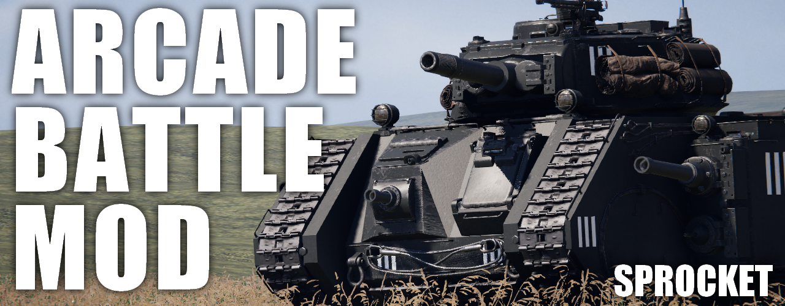

# SPROCKET ARCADE BATTLE MOD

A BepInEx 6 (IL2CPP) mod for [Sprocket](https://store.steampowered.com/app/1674170/Sprocket/) that turns tank combat into an arcade-style experience in the vein of War Thunder and World of Tanks: ballistic prediction, simplified driving, snappy turrets, a kill feed, a minimap, repairs, damage indicators and a less foolish AI.

All features are optional and configurable from a **MODS** tab added to the in-game settings screen.

> **Disclaimer:** this is an unofficial, fan-made mod. It is not affiliated with or endorsed by the developers or publisher of Sprocket. No game files are included in this repository.

## Compatibility

| | |
|---|---|
| Sprocket | 0.2.55.5 (Unity 6000.3.21f1, IL2CPP metadata v39) |
| BepInEx | 6.0.0-be.788 (Bleeding Edge, Unity IL2CPP, Windows x64) |
| OS | Windows 64-bit |

A game update that changes classes or native code can break the mod. See [Troubleshooting](#troubleshooting).

## Installation

1. **Install BepInEx 6 (IL2CPP).** Download build #788 of BepInEx 6 Bleeding Edge for Unity IL2CPP / Windows x64 from <https://builds.bepinex.dev/projects/bepinex_be> and extract it into the Sprocket folder (the one containing `Sprocket.exe`), so that `winhttp.dll` and `doorstop_config.ini` sit next to `Sprocket.exe`.
2. **Run the game once** and close it. BepInEx generates `BepInEx/interop/` on the first launch, which takes a few minutes.
3. **Download the latest zip** from the [Releases](../../releases) page and extract it into the Sprocket folder, merging the `BepInEx` folder. The result:
   - `BepInEx/patchers/Sprocket.Unity6InteropFix.dll` (required, see below)
   - `BepInEx/plugins/SprocketMods/Sprocket.Mods.dll`
   - `BepInEx/plugins/SprocketMods/Languages/`
4. Start the game and open **Settings → MODS**.

To uninstall, delete the files above. Settings are stored in `BepInEx/config/sprocketmods.cfg`.

## Features

### Ballistics HUD

- Computes the trajectory of the main gun in real time from its current orientation and draws a circular crosshair at the impact point.
- Runs the game's own penetration simulator at the impact point and reports the result by crosshair colour and text.
- Shows the distance to the impact point. The trajectory is simulated for the full projectile lifetime, so long-range predictions work.
- The trajectory line is hidden by default (F9 toggles it). `ShowDetails = true` adds impact velocity, flight time and impact angle.

| Label | Colour | Meaning |
|---|---|---|
| PEN | green | Hits an enemy vehicle and penetrates |
| PEN? n/m | yellow | Only some of the samples around the impact point penetrate (plate edges, weak spots) |
| NO PEN | red | Hits an enemy vehicle but does not penetrate |
| RICOCHET | orange | The shell ricochets |
| HE (no AP sim) | yellow | Shell has no armour-piercing function; penetration is not simulated |
| FRIENDLY | blue | Hits a friendly vehicle |
| NOT ENEMY | grey | Hits terrain or a structure |
| OWN VEHICLE | grey | Hits the player's own vehicle |
| NO IMPACT | grey | Nothing is hit within the projectile lifetime |

### Arcade Battle Mode

A driving mode that removes the need to manage gears and RPM: fast acceleration and turning, stable ground contact, no pitching when stopping. It only affects the player's vehicle. The game's powertrain (engine, transmission, track physics) keeps running; the mode adds the following on top.

**Powertrain tuning** (written to the player's instance data only, restored when switched off or when changing vehicle)
- Flattens the torque curve at maximum torque.
- Removes the crew's gear shift wait by zeroing `GearShiftDelay` just before `PowertrainBehaviour.FixedUpdate`.
- Shortens transmission disengage/engage times.

**Driving assist** (closed loop; assist forces act on the centre of mass and do not tilt the hull)
- Longitudinal: a target speed is derived from input and followed with an acceleration based on the engine's maximum power. Releasing the key decelerates at a fixed rate; opposite input brakes. Acceleration does not drop out during gear changes.
- Forward assist is reduced above 94% of maximum RPM, so over-revving damage never occurs and top gear caps at the designed top speed.
- Turning: angular velocity is driven directly toward a target rate (`Rigidbody.AddTorque` is stripped in this build). Turns faster at low speed.
- Stability: sideslip cancellation, pitch and roll damping, ground-pressing force.
- No assist while the engine is off, a track is broken, there is no driver, or the vehicle is airborne.

**Snappy turret and gun**
- Turret and gun move at full speed toward the target with no easing and stop on arrival.
- Axes are driven through `RotationAxisPhysicsRegister`: the game's physics step is skipped for the player's axes and the angle is advanced directly, using the same constraint rules (`ConstrainRotation`).
- Speed is `max(era speed, designed speed × multiplier) × crew factor`. Era is taken from the vehicle design year. Defaults (traverse / elevation, deg/s): up to 1918 12/6, 1935 20/10, 1945 30/15, 1960 40/20, 1961 and later 50/25.
- The crew factor comes from the game's own per-frame axis speed, so a missing gunner or damage still disables the turret as in the base game.
- Aim lock is left to the game.

### Right-click controls (War Thunder style)

| State | Right click | Again |
|---|---|---|
| Looking through the scope | Maximum zoom | Minimum zoom |
| Third person | Commander's cupola view | Back to third person |

- Transitions use easeInOutCubic over `TransitionTime` seconds (default 0.35, range 0.05–0.5); pressing mid-transition reverses from the current point.
- Scope zoom interpolates the focal length of `ScopeCameraController`; the mouse wheel takes priority.
- The cupola view moves the orbital camera's look-at offset to the cupola and the distance to 0; camera control, aiming and shake keep working. The position comes from the commander cupola part (or the highest vision port, or the top of the hull) plus `CupolaHeightOffset`.
- Right click is also the game's "cancel order", so it is ignored while issuing orders or while the cursor is shown.
- Settings: `[Camera]` section and MODS tab.

### Autocannons

Write `[AC magazine/rounds-per-minute]` in the name of a gun, either its design name or the name of the placed gun (the placed name wins), to turn it into an autocannon.

```
20mm Flak [AC 10/450]      10-round magazine, 450 rounds per minute
37mm [AC:6/160rpm]         separators, a trailing "rpm" and full-width brackets are accepted
```

- Guns, shells and visuals are the game's own; shell designs work as usual.
- While the fire button is held the gun fires at the given rate. **One shell in the ammo rack is one magazine**; the rack counter shows remaining magazines.
- When the magazine is empty the loader fetches the next one from the rack. Swap time is fixed (`MagazineReloadTime`, default 5 s) and only advances while the loader is working.
- Optional: no recoil (`NoRecoil`), no muzzle smoke (`NoMuzzleSmoke`), brief flash (`MuzzleFlashTime`, default 0.05 s). Firing sound is kept.
- A small HUD below the crosshair shows remaining rounds and the magazine bar (`ShowHud`).
- AI gunners go through the same code and fire autocannons the same way.
- Settings: `[Autocannon]` section and MODS tab.

Implementation notes:
- `Gunner.ExecutePerform` calls `Fire()` whenever `CanFire` is true and a fire request is held. `CannonBehaviour.FireInternal` then calls `RequestReload`. For autocannons, `RequestReload` is skipped while rounds remain in the magazine and `CanFire` gets a fire-interval limit.
- Magazine swaps replace `LoadTask.Update`; the game's `UpdateRequest` / `SetState` still handle rack extraction and shell type.
- Recoil is removed by skipping `Cannon.OnFire` (`VehicleObject.AddImpulse`) and `VehicleController.OnWeaponFire` (camera shake), and stopping `VisualizeRecoil`.
- Muzzle smoke: the muzzle effect is one VFX graph for flash and smoke with no public switch, so the renderers are hidden shortly after the flash and restored before the next `Setup` (effects are pooled).

Caveats:
- Every round runs the game's full ballistics, penetration and fragment simulation; many fast guns firing at once can be heavy.
- Switching shell type mid-magazine swaps to a magazine of the new type; remaining rounds are not carried over. Whether the loaded magazine returns to the rack follows the game's own ammo-switch logic (untested).

### Shell types (War Thunder style)

Press `1`, `2` or `3` to switch between armour-piercing (AP), armour-piercing high-explosive (APHE) and high-explosive (HE). Any round in the ammunition racks can be fired as any type. Three slots at the bottom centre show the key, the type and its name; the selected slot has a coloured frame and pops when chosen, a pie sweeps behind the slot of the round being loaded, and a dot marks the loaded type. The line above shows the selected type and "Loading 2.4 s" / "Loaded".

- The remaining reload time counts down from the weapon's previous reload (the game's `RemainingLoadTime` only covers part of the loading steps); the first reload is estimated from its progress.
- When your vehicle is destroyed the slots slide down out of view, and the screen turns red at the edges, loses colour and blurs at the edges (`[HudStyle] DeathEffect`): a red vignette overlay plus an HDRP volume with colour adjustments, chromatic aberration and a red vignette.
- Selecting a different type while a round is loaded unloads it and loads the new type (full reload time). Selecting during a reload turns that reload into the new type.
- **AP**: the game's shell, unchanged.
- **APHE**: penetration 15 % lower at 20 mm calibre down to 5 % lower at 150 mm (`ApheLossSmall`, `ApheLossLarge`). After getting through the armour it explodes `ApheFuse` m (default 0.9) further on, or where it stops or leaves the vehicle, and throws fragments in every direction (slightly forward).
- **HE**: one tenth of the penetration (`HePenetration`). If it gets through, it explodes and destroys every part of the vehicle, crew included (`HeDestroysAll`).
- **HE blast**: wherever an HE shell bursts (on a vehicle, penetrating or not, or on the ground), crew it can reach in a straight line are killed by fragments and blast; crew shielded by anything solid are unharmed (`HeKillsExposedCrew`). An open-topped vehicle, or one with a hole, loses the crew the blast can see. Reach: about 4 m at 75 mm, 6.8 m at 150 mm (`HeBlastRadius`). Kills are credited to the shooter.
- The ballistics HUD's penetration verdict uses the loaded type (or the selected one while reloading). The hit camera's title shows the type.
- Settings: `[Ammo]` section (keys, numbers above) and MODS tab.

Implementation:
- **Penetration**: the game's formula (`PenetrationUtils.ComputePenetration`) is `P = c · (√mass · speed / (K · d^a))^n` with K the shell's `PenetratorConstant`. To scale penetration by f, K is multiplied by f^(−1/n); n is measured at runtime by calling the formula with K and 2K (1.43). A Harmony prefix on `CompoundStructure.Penetrate`, the entry point of every penetration calculation, rebuilds the `PenetratorInfo` with the new K when the penetrator is one of the player's shells (the shell IDs from `CannonBehaviour.FireInternal`, matched by the shell's current position and heading in `ProjectileRegister.pool`). Speed and mass are untouched, so damage is unchanged.
- **Explosion**: the postfix checks whether the original penetrator penetrated, finds the burst point along its fragment chain, and runs the game's own penetration simulation (`CompoundStructure.Penetrate`) for each fragment from that point (APHE: 14–48 fragments by calibre, 900 m/s; HE: 24–64, 1100 m/s; together 35 % / 50 % of the shell mass), with `SimulationRan` detached as the ballistics probe does, then `ApplyFragmentHits` damages what they hit. The fragments are added to the hit camera's fragment tree as children of the shell at the burst point. HE then sets every health pool of the vehicle to zero with the game's `HealthUtils.Kill`.
- **Blast**: for every crew seat with health on vehicles within reach, lines are cast from the burst point to three heights above the seat with `CompoundStructure.GetAllIntersections`. The crew member dies if the nearest crossing belongs to their own collider (`ObjectInfo.ID` = the seat's VUID) or nothing is crossed; if the seat's VUID is not in the damage model, the nearest crossing must be within 0.45 m of the body. Ground bursts come from `HitGroundProjectileEvent` in `ProjectileRegister.projectileHistory`. The victim's last attacker is set to the shooter in the kill feed.
- The game's own `ExplosiveProjectileFunction` and `ShrapnelProjectileFunction` are not used: their entry points take `ProjectileInstance`, a struct holding object references, which cannot be passed safely through interop.

### Kill feed

Shows "A destroyed B" in a compact list on the right edge, around the middle of the screen (the top right is used by the hit camera). New entries appear at the top and fade after `Duration` seconds (default 8). `Position = TopRight` restores the old place and `Compact = false` the larger lines.

- Name colours: player gold, friendly blue, enemy red (grey where there are no teams, such as test drives). Entries involving the player have a brighter background.
- Only full destruction counts as a kill (`DestroyedOnly`, default on): the whole crew is out, the vehicle blew up, or its crew abandoned it. Immobilized or disarmed vehicles can be repaired, so they are not kills. The battle result follows the same rule (see below).
- Also reports "immobilized" (cannot move but still armed) with `ShowImmobilized`, and "abandoned" for AI vehicles whose crew bailed out.
- Sentence forms live in the translation files.
- Settings: `[KillFeed]` section and MODS tab.

Implementation: this game build has no kill event (`KillEventArgs` is never constructed; `KillLogger` and `KillObjective` are empty), so kills are detected independently.
- **Destruction**: every vehicle is polled every 0.25 s. It counts as destroyed when all of its crew are out (`VehicleCrewWorkspaceModule` operators) or when it disappears right after a hit (ammunition explosion). With `DestroyedOnly = false` (and always for vehicles without crew), losing both `Mobile` and `Armed` after a hit also counts.
- **Battle result**: the custom battle's `ImmobilizeObjective` defeats a team when fewer than `minMobileCount` of its vehicles are still mobile. A Harmony postfix on `UpdateObjective` recounts with the kill feed's records (standing = not destroyed; destroyed vehicles that vanished are counted per team), so a team is beaten only when its vehicles are actually destroyed. The objective's own entity list (`IObjectiveEntityRegister.GetEntity`) is not called: it returns an `out` struct containing a `Transform`, which crashes the runtime through interop. Objectives that also filter by group, build or spawner (scenarios) keep the game's result.
- **Attribution**: shell IDs returned by `CannonBehaviour.FireInternal` are tracked together with the firing vehicle; when `ProjectileRegister.projectileHistory` yields a `HitDamageModelProjectileEvent`, the hit rigidbody gives the victim. The last vehicle to land a penetrating hit (else any hit) within `AttributionWindow` seconds (default 120) is credited. With no attacker, the entry reads "B destroyed".
- `IProjectileSimulation.TryGetProjectileProjectileInfo` is not used: its `out` struct contains reference types and crashes through interop.

### Hit camera (War Thunder style)

When the player's shell hits a vehicle, a view of the target at the moment of impact appears at the top right. The camera holds the impact point from a fixed angle while the shell flies in. On penetration the hull armour turns translucent grey (the game's own X-ray material) and the interior modules switch to the game's battle overlay material: light blue when intact, black when knocked out. Tracks, wheels, suspension, equipment, stowage, spare track links and add-on plates such as fenders and side skirts stay as a denser light grey, so the vehicle's outline and fittings remain readable while the interior shows through (`FittingOpacity`, also in the MODS tab). Modules damaged by this shot turn red the moment the fragment that damaged them reaches them, with a spark at the point of contact; modules destroyed by it also get a red and yellow outline. Damage that comes later (fires, the health drain after a kill, other shooters) does not colour the modules. Spall fragments are drawn as glowing trails that are thicker closer to the camera; the fragments that damaged a module (and the fragments they split from) stay bright, the others fade soon after landing. Ammunition detonations and engine or fuel fires send large pulsing red rings out from the module. Non-penetrations stop the shell at the surface; ricochets bounce it off. Further hits on the same vehicle while the view is open are added to the same camera, which pans to each new impact point; the view closes `HitDuration` seconds after the last hit. When the target is destroyed while its view is open, the same view shows a "KNOCKED OUT" banner. A kill with no hit view open (for example from a later fire) gets its own view that circles the vehicle while the killing shot is replayed. The model keeps the hull attitude and turret rotation of the moment of impact.

- Non-penetrations and ricochets are shown too (`ShowNonPenetrating`); the kill view can be turned off (`KillCam`).
- Settings: `[HitCam]` section (`Size`, `HitDuration`, `KillDuration`, `Exposure`, `FittingOpacity`, `FittingBrightness`) and MODS tab.

Implementation:
- **Shell and spall paths**: `CompoundStructure.Penetrate` runs a `PenetrationSimulation` per vehicle and passes it to `Vehicle.OnDamageModelSimulationRan`. A Harmony postfix reads the simulation's `fragments` array (the `Fragment` struct is read from memory: spawn point, direction, travel distance, parent index, flags) and converts it with `SimToWorldSpace`. The parent indices form the tree of the shell and its spall; the animation starts each fragment when its parent reaches the spawn point.
- **Pose**: in the same call the vehicle's `rendererRegister` is snapshotted (LOD 0 meshes, including interior parts hidden at distance, with their world matrices; lower LODs and shadow proxies are skipped because they overlap LOD 0 and flicker); skinned meshes are baked. Track links are not in the register: they are taken from each `TrackBelt`'s `TrackBeltRenderer.models`, or, when the belt is drawn with GPU instancing (`TrackBeltInstancedRenderer`, used for most vehicles since 0.2.56), rebuilt the way `SegmentToMatrixJob` does it: `TRS(parent.position, parent.rotation) × TRS((height, 0, forward), Euler(0, angle, -90°), localScale)` from the belt simulation's `segmentTransforms` (read from memory), with the meshes and material of `segmentModelInfo`. Belts are found through `Vehicle.objects` (the transform hierarchy is flattened at runtime). Each track is a module: its links stay in the fitting colour until the track is damaged, then turn red, and black with an outline when it breaks. Parts the game merges into combined meshes (engine, transmission, fuel tanks, turret drives...) carry the `Baked` flag on their originals, but the combined meshes do not always cover the highest detail level, so the originals are captured and the combined meshes (`VehicleRendererAtlaser.combinedMeshes`) are skipped. Ammunition racks are drawn round by round from `AmmoRackModel.models` (the first `displayCap` rounds, the ones still stored) instead of the low-detail placeholder box.
- **Outcome**: `HitDamageModelProjectileEvent.Type` reports `Absorbed` when a shell stops inside the vehicle, so a hit counts as a penetration when interior modules lost health, the shell's fragment chain penetrated, or the event says `Penetrated`. When a hit is confirmed as the player's, readable meshes are duplicated because a destroyed vehicle may rebuild or drop its meshes.
- **Whose shell**: snapshots are taken only while the player has shells in flight. A snapshot is the player's when its shell start point lies on the flight line of one of the player's shells in `ProjectileRegister.pool` (`ProjectileInstance` position and velocity, read from memory) at the time of the penetration calculation. When `ProjectileRegister.projectileHistory` yields a `HitDamageModelProjectileEvent` for one of the player's shell IDs, the snapshot of the same vehicle whose shell ray passes through the hit point is used. Kills come from the kill feed (credited to the player). When one of the player's shells hits a vehicle but no camera is shown, the log gets a `Hit cam: no camera for shot ...` line with each step it went through (penetration calculations near the shell, hit events, why the view skipped it).
- **Modules**: each `healthRegister` entry (component and `HealthPool`) is mapped to its renderers through `VehicleComponent.models`; interior meshes left unmapped (crew figures, merged meshes) are linked to the nearest module (crew to the nearest `CrewSeat`). Health is read from the pool before the hit and once more when the hit is confirmed (the damage has been applied by then). Later changes are ignored. Each damaged module is attributed to the earliest fragment whose path crosses its bounding box (or the closest fragment if none crosses), and the view changes its colour when that fragment arrives. Each health step uses its own copy of the overlay material.
- **Camera angle**: candidate directions around the incoming shell line are tested against the bounding boxes of the other parts so that nothing blocks the view of the impact point.
- **Fittings**: hull, turret, fenders and other plates are all `PlateStructure` components, and the vehicle's transform hierarchy is flattened at runtime, so each renderer is mapped to its structure through `Vehicle.objects` (each `VehicleObject.behaviours`, the structure's high/low detail, shadow and `models` renderers). A structure counts as armour when it contains the shell's entry point, the position of an interior module, or at least 30% of a module's bounding box (a gun shield around the gun); any other structure is a fitting. Fittings use a copy of the X-ray material with higher alpha and a lighter colour.
- **Rendering**: the snapshot is rebuilt as a model far above the map on an unused layer and drawn by a separate HDRP camera into a `RenderTexture` (solid background, its own volume with fixed exposure and no motion blur, NaN pixels stopped so a stray one cannot black out the frame; other cameras exclude the layer). Exterior parts (`BattleOverlay.XRayFilter`: plates, applique armour, turret ring, stowage, equipment) switch to the X-ray material of `VehicleBattleOverlayController` at the moment of impact. Paths and markers are drawn as UI lines over the image, projected with the same camera.

### Hit report

When the player's shell hits, a result is shown under the crosshair: a headline (destroyed in red, penetrated in orange, not penetrated in grey, ricochet in blue-grey; repeated hits on the same target are merged with `×count`) followed by the modules and crew affected (destroyed or killed in red, damaged in orange to yellow with remaining health %). Crew are named by their current role. A diamond marker briefly appears at the damaged module (`ShowMarkers`).

Implementation:
- Shells are tracked by the IDs returned by `FireInternal`; `HitDamageModelProjectileEvent.Type` (Penetrated / Absorbed / Deflected) gives the outcome.
- Damage is read directly from each vehicle's `healthRegister.entries` (part and `HealthPool` pairs) and compared with the health before the hit. Tracking continues for 3 s after a hit to include fires and secondary explosions.
- Crew roles come from the operator's `ActiveRoleID` and the matching task's `IconIdentifier`.
- Settings: `[HitReport]` section and MODS tab.

### Target info

Aiming at a vehicle shows its information above the crosshair, and it disappears when the aim leaves.

- Line 1: enemy (red) or friendly (blue) and vehicle name; "enemy wreck" / "friendly wreck" when destroyed.
- Line 2: operational / immobilized / destroyed, fire, distance.
- Crew: living / total, wounded count, roles of the dead.
- Modules: engine always; transmission, gun, breech, ammo rack, fuel tank, tracks and turret drive only when damaged.
- The player's own vehicle is excluded, and nothing is shown when terrain or a building is in the way.
- Every element can be toggled and the size and maximum range set (`[TargetInfo]` section and MODS tab).

Implementation: a ray from the screen centre is cast against each vehicle's damage model (`CompoundStructure.Raycast`); state comes from the kill detection and from reading health pools directly.

### Team strength bar (War Thunder style)

In custom battles and scenarios, a gauge at the top centre shows the remaining vehicles for the friendly side (left, blue) and the enemy side (right, red). It grows from the centre outward and darkens from the outside as vehicles are destroyed (with a brief white flash). Above 40 vehicles it becomes a single bar.

It is a guide only: reaching zero does not end the match. Destruction uses the same detection as the kill feed; vehicles that vanish count as destroyed; if more than half disappear at once (match reset, leaving) the count restarts. Settings: `[TeamBar]` section and MODS tab (Map page).

### Minimap (War Thunder style)

A map at the bottom left (north up), shown only while controlling a vehicle.

- **Terrain**: built from the Unity Terrain (MapMagic tiles). Colour is blended from each terrain layer's average texture colour by splat weight, desaturated and brightened to look like a map. Relief shading uses a north-west light with exaggerated height. Contour interval is chosen from the height range (2/5/10/20 m…) with every fifth line emphasised.
- **Extent**: the whole terrain up to 4.2 km per side; larger maps use a square centred on where vehicles are. Generation takes a few frames.
- **Grid**: column numbers on top, row letters on the left, cell size at the bottom right.
- **Vehicles**: arrows showing heading. Player gold, friendly blue, enemy red; destroyed vehicles are dark crosses; vehicles outside the map are pinned to the edge. Two lines show the camera direction and field of view.
- Settings: `[Minimap]` section and MODS tab (size, show enemies, grid, view direction, contours). `DebugLog = true` writes the generated map to `BepInEx/minimap_debug.png`.

### Repair (War Thunder style)

Hold `F` (`[Repair] Key`) for 1 second to start repairing; after that the key can be released. When the repair time elapses, everything except the engine is fixed.

- A white ring at the bottom centre sweeps once during the hold, then fills over the repair time, with remaining seconds shown. Holding `F` again for 1 s cancels.
- While repairing, all WASD input is ignored (also cruise control and AI driving): the driver's `Solution` is zeroed before `Driver.ExecutePerform`, so neither the engine nor the transmission reacts. The vehicle is held in place by cancelling horizontal velocity and yaw every physics step and easing it back to the start pose. `Rigidbody.constraints` is not used because it breaks the track physics.
- Repair time = `BaseTime` (default 20 s) × √(4 / full crew) × (full crew / living crew). More crew is faster, losing crew makes it longer (a five-man vehicle: 17.9 s, 29.8 s after losing two). It cannot be done with no crew alive.
- Track belts can be damaged too (`[TrackDamage]`, default on). The game gives each track (`TrackAssembly`, one per side) a health pool that breaks the track at zero, but only builds damage colliders for the wheels and axles. A postfix on `TrackAssembly.BuildDamageModelColliders` adds one box per link along the belt's rest path (`TrackBelt.segmentPoints`, belt space `(0, y, x)` like `TrackBelt.ToLocalSpace`; width × thickness × pitch) with the track's VUID and entity, so hits on the belt drain that track's health. The armour values are those of spare track links (`TrackBeltSegmentArray.DamageModelParameters`) times `ArmourFactor`. Applies to vehicles built afterwards.
- Repaired: part health (via the game's `HealthUtils.FullyHeal`) and broken tracks. Tracks clear `TrackAssembly.Broken`, the belt simulation's `broken` state and every link's `SegmentFlags.Broken`, then `ResetPositions` re-fits the belt around the wheels. The engine (`CombustionEngine`, `EngineVent`, `EngineExhaust`) and crew are not repaired, and fires are not extinguished.
- AI vehicles start repairing `AiDelay` seconds (default 3) after noticing damage (`AiRepair`) and also stand still.
- A hint such as "Hold [F] to repair (18 s)" is shown when something can be repaired (`ShowHint`). `F` is also bound to cruise-control slowdown by default; change the key if that conflicts.
- Settings: `[Repair]` section and MODS tab (Weapons & camera page).

### Damage direction indicator (War Thunder / WoT style)

When the player's vehicle is hit, an arc around the crosshair points toward the shooter and rotates with the camera. Red is a penetration, orange non-penetrating, grey-blue a ricochet. The arc starts large and bright and fades over `Duration`. Hits from the same direction (±12°) in succession are merged. Implementation tracks other vehicles' shell IDs and muzzle positions at firing time and matches `HitDamageModelProjectileEvent` on the player's rigidbody. Settings: `[DamageIndicator]` section and MODS tab (Combat HUD page).

### AI improvements

Fixes the most foolish behaviours of the game's AI. Code is in `Ai/AiDirector.cs`. The MODS tab's AI page and the `[AI]` section select the strength (Recruit / Regular / Veteran / Ace).

- **Human-like aim**: the game's range/velocity error and bracketing table (near-zero error after 6 shots) are replaced. After `FindAndAimAtTargetGunLayerTask.Update`, a random error is added to the aim. Standard deviation = `max(floor, first-shot error × (1 − correction)^shots) × strength scale`.
  - First-shot error = 0.3 + 0.0019 × distance (m); floor = 0.25 + 0.00075 × distance.
  - Correction per shot: Recruit 20%, Regular 30%, Veteran 40%, Ace 50%. Scale: 1.8 / 1 / 0.75 / 0.5.
  - 3× while the AI is moving, 1.5× for 2 s after being hit. Moving more than 10 m or a sudden target speed change undoes half of the correction.
  - Reaction: the game's 1 s acquire delay plus 1–2 / 0.2–0.6 / 0–0.2 / 0 s, and the game's 0.1–0.5 s fire delay plus 0.6–1 / 0.2–0.35 / 0.05–0.15 / 0 s (Recruit / Regular / Veteran / Ace).
  - The fire tolerance is tightened from 0.6° to 0.25° (0.6° is 6 m off at 600 m).
  - With several guns, only the correction of the aim closest to the firing gun advances.
  - Measured (Regular, 234 shots; 1st / 2nd / 3rd / 4th+): under 400 m 23 / 83 / 83 / 93%, 400–800 m 22 / 67 / 82 / 84%, over 800 m 11 / 33 / 50%.
- **Turret watches threats**: with no target, the turret points toward where it was last shot from (15 s), where a target was last seen (30 s), then the enemy side (centroid of enemy spawns).
- **Hearing**: the player's gunfire is registered as noise (`AINoiseRegister`, 160 dB at 1 m); the game only does this for AI shots. The AI looks toward noise first.
- **Reacting to hits**: the shooter's position is remembered as a threat and the commander's view turns toward it.
- **Safe driving**: automatic reversing is disabled (`DriverAI.reverseAllowed = false`; the vehicle turns in place and drives forward instead). When pushed (sliding over 3.5 m/s for 0.5 s, or yaw over 80°/s for 0.3 s without steering), it stops for 1 s and re-plans. Full throttle for 6 s with under 2 m moved triggers a 2.5 s back-off and re-plan (up to 3 times; immobilized vehicles excluded).
- **Abandon when flipped or stuck** (`AutoAbandon`): an AI vehicle tilted more than 70° and stationary for `FlipTime` (10) s, or trying to move without making 4 m of progress for a total of `StuckTime` (30) s, is abandoned by its crew (crew seat health set to 0 with the game's `HealthUtils.Kill`, which counts as knocked out). The kill feed shows "abandoned" with no attacker. Vehicles that can still shoot while immobile, time spent stopped to fire, and repair time are not counted.
- `Log = true` writes hit rates by distance and shot number every 60 s, and driving recoveries as they happen.

### Cylinder turret (32 sides)

Selecting a generated turret in the designer adds a **Use cylinder shape** toggle. Turning it on replaces the turret with a 32-sided cylinder, with sliders for diameter, height and side, roof and bottom armour. Slider changes are applied when the slider stops moving, so each one is a single undo step.

- Saved as an ordinary freeform mesh (`format: freeform`), so the design also opens without the mod. The sliders come back when the design is reopened, because the dimensions are read from the vertex layout; manually editing the vertices ends this and leaves a normal freeform turret.
- The bottom has a hole matching the turret ring, and it follows the ring when the turret is selected again after a ring size change.
- The smoothing angle is set to 20°, so the sides shade as a round surface while the roof edge stays sharp.
- Applied through the game's `PlateStructureEditor.LoadBlueprint`, so undo restores the previous shape.
- Settings: `[Design]` section and MODS tab (General page).

### Sandbox spawn menu

While driving in a sandbox map, press `Z` (`[Sandbox] SpawnMenuKey`) to open the game's blueprint list with your vehicle designs. The chosen vehicle replaces the target that is automatically spawned as a copy of your own design, at the same spawn position. The game is paused while the list is open.

The game still ships the input binding (`Sandbox/OpenSpawnMenu`) but no longer has the menu. The list uses `VehicleBlueprintSelector.Select`, and the replacement disposes the spawns of the `StageVehicleSpawnEvent` whose `VehicleSource.Mode` is `EditorExitSave`, then spawns through its `VehicleSpawner` and repeats the same post-spawn steps as the game. Restarting the mission returns the target to a copy of your own design.

### HUD style

All HUD elements (hit report, target info, autocannon ammo, kill feed, ballistics labels) sit on rounded, translucent dark panels so they stay readable on bright backgrounds, with a coloured stripe on the left edge indicating type. Rows align as name, bar, value. `[HudStyle] PanelOpacity` sets panel darkness (0 for none) and `[HudStyle] Scale` the overall size; both are also in the MODS tab.

### Localization

Display text is replaced at the moment it is shown, using a dictionary keyed by the English original. A Japanese translation (about 1,300 entries covering the game UI, part names, descriptions and scenarios) is included and doubles as a **template for other languages**: `python tools/translations.py template Languages/ja Languages/<code>` creates an empty copy to fill in. Other languages are added by creating a `Languages/<code>/` folder; see [SprocketMods/Languages/README.md](SprocketMods/Languages/README.md) for the file format. Translations contributed by others are welcome.

- Hooks: `TMP_Text.text`, `TMP_Text.SetText`, `TextMeshProUGUI.OnEnable` (scene-stored text) and uGUI `Text.text`. Nothing depends on game-specific classes, so game updates that add text do not require rebuilding the mod.
- Matching order: exact match, numbers templated (`Speed 12 km/h` → `Speed {0} km/h`), regular expression, trimmed whitespace / rich-text tags / trailing colon, and per line for multi-line text.
- Untranslated text is collected into `Languages/<code>/_untranslated.txt` for later translation; F11 reloads the files.
- Fonts: the game's font is Latin-only, so dynamic fonts listed in `font.txt` are created with `TMP_FontAsset.CreateFontAsset` and registered as fallbacks for every TMP font.
- Input fields are never translated. Language is chosen in the MODS tab (`auto` follows the Windows display language).
- `tools/translations.py` provides `check`, `template` and `merge-untranslated`.

### MODS settings tab

Pages: General, Driving, Weapons & camera, Combat HUD, Map, Target HUD, Ballistics HUD, AI. The tab is built by injecting a `SettingsSubMenu` subclass into IL2CPP and appending it to `SettingsMenu.subMenus` with Harmony. Changes apply immediately and are saved automatically; all values including keys and colours are in `BepInEx/config/sprocketmods.cfg`.

## Controls

| Key | Action |
|---|---|
| F8 | Show / hide the HUD |
| F9 | Show / hide the trajectory line |
| F10 | Arcade Battle Mode on / off |
| F11 | Reload translation files |
| F (hold) | Repair |
| 1 / 2 / 3 | Shell type: AP / APHE / HE |
| Z | Sandbox spawn menu (while driving) |
| Right click | Scope: max ⇔ min zoom. Third person: cupola ⇔ third-person view |

## Repository layout

| Folder | Output | Contents |
|---|---|---|
| `Unity6InteropFix/` | `BepInEx/patchers/` | **Required.** Patcher that avoids a startup crash of BepInEx on Unity 6000.3 |
| `SprocketMods/` | `BepInEx/plugins/SprocketMods/` | The mod itself |
| `tools/` | not distributed | `translations.py` (translation file checker and template generator), `disasm/` (game code inspector), `game/` (scripts that drive the game for testing) |
| `assets/` | not distributed | README images |

### Why Unity6InteropFix is required

The Il2CppInterop 1.5.3 bundled with BepInEx 6 BE #788 natively hooks `Class::GetDefaultFieldValue` at startup. On Sprocket (Unity 6000.3.21, IL2CPP metadata v39) the lookup finds a different function, and the game crashes with `AccessViolationException at Class_GetFieldDefaultValue_Hook.Hook` even with no plugins. The hook is only used for injecting custom enums, so the patcher runs `InjectorHelpers.Setup()` without it.

On Unity 6000.3, `il2cpp_format_exception` itself also raises an access violation, so a single IL2CPP exception, even one the mod would catch, takes the game down. `Il2CppException.ParseMessageHook` is replaced with a safe implementation that reads only the class name and `_message`.

## How the ballistics work

Calculations follow the game's own projectile and penetration code, using the same inputs.

**Trajectory** (same as `ProjectileInstance.Update`)
- Spawn position is `WeaponBehaviour.ShellSpawnPosition`; direction is the forward of the last barrel transform.
- Muzzle velocity is `ShellProperties.CalculateFireInfo(barrel length, calibre, shell length, charge length, max pressure)` plus the vehicle's velocity.
- Each step: `a = g − v̂ · CalculateDragForce(|v|) / mass`, `v += a·dt`, `p += v·dt` (dt = fixed update interval).
- Hit tests: vehicles use every damage model's AABB then `CompoundStructure.Raycast`; terrain uses `Physics.Raycast` with `ProjectilesMain.ProjectileLayerMask`. Steps are batched into 0.04 s chords and only a hit chord is re-tested step by step.
- `DamageModel.Raycast` is not used: `DamageModelHit` contains reference types and passing it as `out` through Il2CppInterop corrupts memory.
- Drag is interpolated from a per-shell table precomputed at 1 m/s steps. The shell ends below `MinSpeed` or after `Lifetime`.
- Random launch dispersion is not modelled; the prediction is the centre of the spread.

**Penetration** (same inputs as `ArmourPiercingProjectileFunction.HitDamageModel`)
- A `PenetratorInfo(mass, diameter, ProjectileConstants.MetalDensity, 5°, PenetratorConstant, impact point, impact velocity)` is passed to the hit vehicle's `CompoundStructure.Penetrate()`, and the flags of the first fragment (Penetrated / Deflected / Embedded) give the result. `GetFragment()` is not used for the same out-struct reason; the `fragments` array is read directly from memory (offsets resolved from IL2CPP metadata at runtime).
- `Penetrate()` fires `SimulationRan`, whose subscribers apply damage, camera shake and AI reactions, so the event is detached during the prediction call and restored immediately; predictions never damage enemies.
- Samples are also taken around the impact point (default: 4 points on a one-calibre circle plus the centre); split results are reported as partial penetration.

**Teams**: `CompoundStructure.ID.TeamID` is compared with the player's team (the damage model whose rigidbody matches). When the player's team is `None` (design-screen test drives), every other vehicle is treated as an enemy.

## Building

Requires the .NET SDK 6 or later. Build after BepInEx has generated `BepInEx/interop/` by running the game once. Place this folder at `Sprocket/_ModSource`.

```
dotnet build Unity6InteropFix -c Release
dotnet build SprocketMods -c Release
```

The DLLs are copied to the game's `BepInEx/patchers/` and `BepInEx/plugins/SprocketMods/` automatically (the copy fails while the game is running). If the game lives elsewhere, change `GameDir` in `Directory.Build.props`.

## Troubleshooting

- A game update that changes classes or native code can break the mod. Delete `BepInEx/interop/` so BepInEx regenerates it, then rebuild.
- Check `BepInEx/LogOutput.log` when something fails. `DebugLog = true` logs shell parameters and results.
- If the game crashes right after launching, make sure `BepInEx/patchers/Sprocket.Unity6InteropFix.dll` is present.

## License

[MIT](LICENSE). You may redistribute and modify this mod; it comes with no warranty and the author takes no responsibility for any damage or loss from using it.
