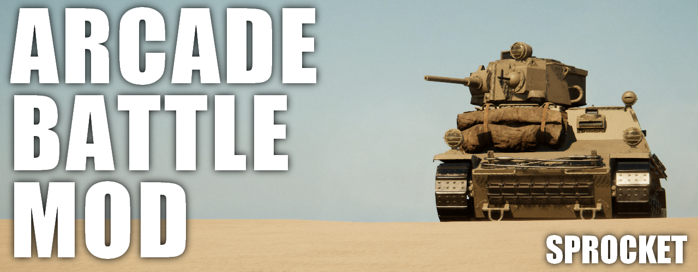

# SPROCKET ARCADE BATTLE MOD

A BepInEx 6 (IL2CPP) mod for [Sprocket](https://store.steampowered.com/app/1674170/Sprocket/) that turns tank combat into an arcade-style experience in the vein of War Thunder and World of Tanks: ballistic prediction, simplified driving, snappy turrets, a kill feed, a minimap, repairs, damage indicators and a less foolish AI.

All features are optional and configurable from a **MODS** tab added to the in-game settings screen.

> **Disclaimer:** this is an unofficial, fan-made mod. It is not affiliated with or endorsed by the developers or publisher of Sprocket. No game files are included in this repository.

## Compatibility

| | |
|---|---|
| Sprocket | 0.2.55.5 (Unity 6000.3.21f1, IL2CPP metadata v39) |
| BepInEx | 6.0.0-be.788 (Bleeding Edge, Unity IL2CPP, Windows x64) |
| OS | Windows 64-bit |

A game update that changes classes or native code can break the mod. See [Troubleshooting](#troubleshooting).

## Installation

1. **Install BepInEx 6 (IL2CPP).** Download build #788 of BepInEx 6 Bleeding Edge for Unity IL2CPP / Windows x64 from <https://builds.bepinex.dev/projects/bepinex_be> and extract it into the Sprocket folder (the one containing `Sprocket.exe`), so that `winhttp.dll` and `doorstop_config.ini` sit next to `Sprocket.exe`.
2. **Run the game once** and close it. BepInEx generates `BepInEx/interop/` on the first launch, which takes a few minutes.
3. **Download the latest zip** from the [Releases](../../releases) page and extract it into the Sprocket folder, merging the `BepInEx` folder. The result:
   - `BepInEx/patchers/Sprocket.Unity6InteropFix.dll` (required, see below)
   - `BepInEx/plugins/SprocketMods/Sprocket.Mods.dll`
   - `BepInEx/plugins/SprocketMods/Languages/`
4. Start the game and open **Settings → MODS**.

To uninstall, delete the files above. Settings are stored in `BepInEx/config/sprocketmods.cfg`.

## Features

### Ballistics HUD

- Computes the trajectory of the main gun in real time from its current orientation and draws a circular crosshair at the impact point.
- Runs the game's own penetration simulator at the impact point and reports the result by crosshair colour and text.
- Shows the distance to the impact point. The trajectory is simulated for the full projectile lifetime, so long-range predictions work.
- The trajectory line is hidden by default (F9 toggles it). `ShowDetails = true` adds impact velocity, flight time and impact angle.

| Label | Colour | Meaning |
|---|---|---|
| PEN | green | Hits an enemy vehicle and penetrates |
| PEN? n/m | yellow | Only some of the samples around the impact point penetrate (plate edges, weak spots) |
| NO PEN | red | Hits an enemy vehicle but does not penetrate |
| RICOCHET | orange | The shell ricochets |
| HE (no AP sim) | yellow | Shell has no armour-piercing function; penetration is not simulated |
| FRIENDLY | blue | Hits a friendly vehicle |
| NOT ENEMY | grey | Hits terrain or a structure |
| OWN VEHICLE | grey | Hits the player's own vehicle |
| NO IMPACT | grey | Nothing is hit within the projectile lifetime |

### Arcade Battle Mode

A driving mode that removes the need to manage gears and RPM: fast acceleration and turning, stable ground contact, no pitching when stopping. It only affects the player's vehicle. The game's powertrain (engine, transmission, track physics) keeps running; the mode adds the following on top.

**Powertrain tuning** (written to the player's instance data only, restored when switched off or when changing vehicle)
- Flattens the torque curve at maximum torque.
- Removes the crew's gear shift wait by zeroing `GearShiftDelay` just before `PowertrainBehaviour.FixedUpdate`.
- Shortens transmission disengage/engage times.

**Driving assist** (closed loop; assist forces act on the centre of mass and do not tilt the hull)
- Longitudinal: a target speed is derived from input and followed with an acceleration based on the engine's maximum power. Releasing the key decelerates at a fixed rate; opposite input brakes. Acceleration does not drop out during gear changes.
- Forward assist is reduced above 94% of maximum RPM, so over-revving damage never occurs and top gear caps at the designed top speed.
- Turning: angular velocity is driven directly toward a target rate (`Rigidbody.AddTorque` is stripped in this build). Turns faster at low speed.
- Stability: sideslip cancellation, pitch and roll damping, ground-pressing force.
- No assist while the engine is off, a track is broken, there is no driver, or the vehicle is airborne.

**Snappy turret and gun**
- Turret and gun move at full speed toward the target with no easing and stop on arrival.
- Axes are driven through `RotationAxisPhysicsRegister`: the game's physics step is skipped for the player's axes and the angle is advanced directly, using the same constraint rules (`ConstrainRotation`).
- Speed is `max(era speed, designed speed × multiplier) × crew factor`. Era is taken from the vehicle design year. Defaults (traverse / elevation, deg/s): up to 1918 12/6, 1935 20/10, 1945 30/15, 1960 40/20, 1961 and later 50/25.
- The crew factor comes from the game's own per-frame axis speed, so a missing gunner or damage still disables the turret as in the base game.
- Aim lock is left to the game.

### Right-click controls (War Thunder style)

| State | Right click | Again |
|---|---|---|
| Looking through the scope | Maximum zoom | Minimum zoom |
| Third person | Commander's cupola view | Back to third person |

- Transitions use easeInOutCubic over `TransitionTime` seconds (default 0.35, range 0.05–0.5); pressing mid-transition reverses from the current point.
- Scope zoom interpolates the focal length of `ScopeCameraController`; the mouse wheel takes priority.
- The cupola view moves the orbital camera's look-at offset to the cupola and the distance to 0; camera control, aiming and shake keep working. The position comes from the commander cupola part (or the highest vision port, or the top of the hull) plus `CupolaHeightOffset`.
- Right click is also the game's "cancel order", so it is ignored while issuing orders or while the cursor is shown.
- Settings: `[Camera]` section and MODS tab.

### Autocannons

Write `[AC magazine/rounds-per-minute]` in the name of a gun, either its design name or the name of the placed gun (the placed name wins), to turn it into an autocannon.

```
20mm Flak [AC 10/450]      10-round magazine, 450 rounds per minute
37mm [AC:6/160rpm]         separators, a trailing "rpm" and full-width brackets are accepted
```

- Guns, shells and visuals are the game's own; shell designs work as usual.
- While the fire button is held the gun fires at the given rate. **One shell in the ammo rack is one magazine**; the rack counter shows remaining magazines.
- When the magazine is empty the loader fetches the next one from the rack. Swap time is fixed (`MagazineReloadTime`, default 5 s) and only advances while the loader is working.
- Optional: no recoil (`NoRecoil`), no muzzle smoke (`NoMuzzleSmoke`), brief flash (`MuzzleFlashTime`, default 0.05 s). Firing sound is kept.
- A small HUD below the crosshair shows remaining rounds and the magazine bar (`ShowHud`).
- AI gunners go through the same code and fire autocannons the same way.
- Settings: `[Autocannon]` section and MODS tab.

Implementation notes:
- `Gunner.ExecutePerform` calls `Fire()` whenever `CanFire` is true and a fire request is held. `CannonBehaviour.FireInternal` then calls `RequestReload`. For autocannons, `RequestReload` is skipped while rounds remain in the magazine and `CanFire` gets a fire-interval limit.
- Magazine swaps replace `LoadTask.Update`; the game's `UpdateRequest` / `SetState` still handle rack extraction and shell type.
- Recoil is removed by skipping `Cannon.OnFire` (`VehicleObject.AddImpulse`) and `VehicleController.OnWeaponFire` (camera shake), and stopping `VisualizeRecoil`.
- Muzzle smoke: the muzzle effect is one VFX graph for flash and smoke with no public switch, so the renderers are hidden shortly after the flash and restored before the next `Setup` (effects are pooled).

Caveats:
- Every round runs the game's full ballistics, penetration and fragment simulation; many fast guns firing at once can be heavy.
- Switching shell type mid-magazine swaps to a magazine of the new type; remaining rounds are not carried over. Whether the loaded magazine returns to the rack follows the game's own ammo-switch logic (untested).

### Kill feed

Shows "A destroyed B" at the top right. New entries appear at the top and fade after `Duration` seconds (default 8).

- Name colours: player gold, friendly blue, enemy red (grey where there are no teams, such as test drives). Entries involving the player have a brighter background.
- Also reports "immobilized" (cannot move but still armed) with `ShowImmobilized`, and "abandoned" for AI vehicles whose crew bailed out.
- Sentence forms live in the translation files.
- Settings: `[KillFeed]` section and MODS tab.

Implementation: this game build has no kill event (`KillEventArgs` is never constructed; `KillLogger` and `KillObjective` are empty), so kills are detected independently.
- **Destruction**: `VehicleFlags` of every vehicle are polled every 0.25 s; a vehicle that loses both `Mobile` and `Armed` counts as destroyed. A vehicle that disappears right after a hit (ammunition explosion) also counts.
- **Attribution**: shell IDs returned by `CannonBehaviour.FireInternal` are tracked together with the firing vehicle; when `ProjectileRegister.projectileHistory` yields a `HitDamageModelProjectileEvent`, the hit rigidbody gives the victim. The last vehicle to land a penetrating hit (else any hit) within `AttributionWindow` seconds (default 120) is credited. With no attacker, the entry reads "B destroyed".
- `IProjectileSimulation.TryGetProjectileProjectileInfo` is not used: its `out` struct contains reference types and crashes through interop.

### Hit report

When the player's shell hits, a result is shown under the crosshair: a headline (destroyed in red, penetrated in orange, not penetrated in grey, ricochet in blue-grey; repeated hits on the same target are merged with `×count`) followed by the modules and crew affected (destroyed or killed in red, damaged in orange to yellow with remaining health %). Crew are named by their current role. A diamond marker briefly appears at the damaged module (`ShowMarkers`).

Implementation:
- Shells are tracked by the IDs returned by `FireInternal`; `HitDamageModelProjectileEvent.Type` (Penetrated / Absorbed / Deflected) gives the outcome.
- Damage is read directly from each vehicle's `healthRegister.entries` (part and `HealthPool` pairs) and compared with the health before the hit. Tracking continues for 3 s after a hit to include fires and secondary explosions.
- Crew roles come from the operator's `ActiveRoleID` and the matching task's `IconIdentifier`.
- Settings: `[HitReport]` section and MODS tab.

### Target info

Aiming at a vehicle shows its information above the crosshair, and it disappears when the aim leaves.

- Line 1: enemy (red) or friendly (blue) and vehicle name; "enemy wreck" / "friendly wreck" when destroyed.
- Line 2: operational / immobilized / destroyed, fire, distance.
- Crew: living / total, wounded count, roles of the dead.
- Modules: engine always; transmission, gun, breech, ammo rack, fuel tank, tracks and turret drive only when damaged.
- The player's own vehicle is excluded, and nothing is shown when terrain or a building is in the way.
- Every element can be toggled and the size and maximum range set (`[TargetInfo]` section and MODS tab).

Implementation: a ray from the screen centre is cast against each vehicle's damage model (`CompoundStructure.Raycast`); state comes from the kill detection and from reading health pools directly.

### Team strength bar (War Thunder style)

In custom battles and scenarios, a gauge at the top centre shows the remaining vehicles for the friendly side (left, blue) and the enemy side (right, red). It grows from the centre outward and darkens from the outside as vehicles are destroyed (with a brief white flash). Above 40 vehicles it becomes a single bar.

It is a guide only: reaching zero does not end the match. Destruction uses the same detection as the kill feed; vehicles that vanish count as destroyed; if more than half disappear at once (match reset, leaving) the count restarts. Settings: `[TeamBar]` section and MODS tab (Map page).

### Minimap (War Thunder style)

A map at the bottom left (north up), shown only while controlling a vehicle.

- **Terrain**: built from the Unity Terrain (MapMagic tiles). Colour is blended from each terrain layer's average texture colour by splat weight, desaturated and brightened to look like a map. Relief shading uses a north-west light with exaggerated height. Contour interval is chosen from the height range (2/5/10/20 m…) with every fifth line emphasised.
- **Extent**: the whole terrain up to 4.2 km per side; larger maps use a square centred on where vehicles are. Generation takes a few frames.
- **Grid**: column numbers on top, row letters on the left, cell size at the bottom right.
- **Vehicles**: arrows showing heading. Player gold, friendly blue, enemy red; destroyed vehicles are dark crosses; vehicles outside the map are pinned to the edge. Two lines show the camera direction and field of view.
- Settings: `[Minimap]` section and MODS tab (size, show enemies, grid, view direction, contours). `DebugLog = true` writes the generated map to `BepInEx/minimap_debug.png`.

### Repair (War Thunder style)

Hold `F` (`[Repair] Key`) for 1 second to start repairing; after that the key can be released. When the repair time elapses, everything except the engine is fixed.

- A white ring at the bottom centre sweeps once during the hold, then fills over the repair time, with remaining seconds shown. Holding `F` again for 1 s cancels.
- While repairing, all WASD input is ignored (also cruise control and AI driving): the driver's `Solution` is zeroed before `Driver.ExecutePerform`, so neither the engine nor the transmission reacts. The vehicle is held in place by cancelling horizontal velocity and yaw every physics step and easing it back to the start pose. `Rigidbody.constraints` is not used because it breaks the track physics.
- Repair time = `BaseTime` (default 20 s) × √(4 / full crew) × (full crew / living crew). More crew is faster, losing crew makes it longer (a five-man vehicle: 17.9 s, 29.8 s after losing two). It cannot be done with no crew alive.
- Repaired: part health (via the game's `HealthUtils.FullyHeal`) and broken tracks. Tracks clear `TrackAssembly.Broken`, the belt simulation's `broken` state and every link's `SegmentFlags.Broken`, then `ResetPositions` re-fits the belt around the wheels. The engine (`CombustionEngine`, `EngineVent`, `EngineExhaust`) and crew are not repaired, and fires are not extinguished.
- AI vehicles start repairing `AiDelay` seconds (default 3) after noticing damage (`AiRepair`) and also stand still.
- A hint such as "Hold [F] to repair (18 s)" is shown when something can be repaired (`ShowHint`). `F` is also bound to cruise-control slowdown by default; change the key if that conflicts.
- Settings: `[Repair]` section and MODS tab (Weapons & camera page).

### Damage direction indicator (War Thunder / WoT style)

When the player's vehicle is hit, an arc around the crosshair points toward the shooter and rotates with the camera. Red is a penetration, orange non-penetrating, grey-blue a ricochet. The arc starts large and bright and fades over `Duration`. Hits from the same direction (±12°) in succession are merged. Implementation tracks other vehicles' shell IDs and muzzle positions at firing time and matches `HitDamageModelProjectileEvent` on the player's rigidbody. Settings: `[DamageIndicator]` section and MODS tab (Combat HUD page).

### AI improvements

Fixes the most foolish behaviours of the game's AI. Code is in `Ai/AiDirector.cs`. The MODS tab's AI page and the `[AI]` section select the strength (Recruit / Regular / Veteran / Ace).

- **Human-like aim**: the game's range/velocity error and bracketing table (near-zero error after 6 shots) are replaced. After `FindAndAimAtTargetGunLayerTask.Update`, a random error is added to the aim. Standard deviation = `max(floor, first-shot error × (1 − correction)^shots) × strength scale`.
  - First-shot error = 0.3 + 0.0019 × distance (m); floor = 0.25 + 0.00075 × distance.
  - Correction per shot: Recruit 20%, Regular 30%, Veteran 40%, Ace 50%. Scale: 1.8 / 1 / 0.75 / 0.5.
  - 3× while the AI is moving, 1.5× for 2 s after being hit. Moving more than 10 m or a sudden target speed change undoes half of the correction.
  - Reaction: the game's 1 s acquire delay plus 1–2 / 0.2–0.6 / 0–0.2 / 0 s, and the game's 0.1–0.5 s fire delay plus 0.6–1 / 0.2–0.35 / 0.05–0.15 / 0 s (Recruit / Regular / Veteran / Ace).
  - The fire tolerance is tightened from 0.6° to 0.25° (0.6° is 6 m off at 600 m).
  - With several guns, only the correction of the aim closest to the firing gun advances.
  - Measured (Regular, 234 shots; 1st / 2nd / 3rd / 4th+): under 400 m 23 / 83 / 83 / 93%, 400–800 m 22 / 67 / 82 / 84%, over 800 m 11 / 33 / 50%.
- **Turret watches threats**: with no target, the turret points toward where it was last shot from (15 s), where a target was last seen (30 s), then the enemy side (centroid of enemy spawns).
- **Hearing**: the player's gunfire is registered as noise (`AINoiseRegister`, 160 dB at 1 m); the game only does this for AI shots. The AI looks toward noise first.
- **Reacting to hits**: the shooter's position is remembered as a threat and the commander's view turns toward it.
- **Safe driving**: automatic reversing is disabled (`DriverAI.reverseAllowed = false`; the vehicle turns in place and drives forward instead). When pushed (sliding over 3.5 m/s for 0.5 s, or yaw over 80°/s for 0.3 s without steering), it stops for 1 s and re-plans. Full throttle for 6 s with under 2 m moved triggers a 2.5 s back-off and re-plan (up to 3 times; immobilized vehicles excluded).
- **Abandon when flipped or stuck** (`AutoAbandon`): an AI vehicle tilted more than 70° and stationary for `FlipTime` (10) s, or trying to move without making 4 m of progress for a total of `StuckTime` (30) s, is abandoned by its crew (crew seat health set to 0 with the game's `HealthUtils.Kill`, which counts as knocked out). The kill feed shows "abandoned" with no attacker. Vehicles that can still shoot while immobile, time spent stopped to fire, and repair time are not counted.
- `Log = true` writes hit rates by distance and shot number every 60 s, and driving recoveries as they happen.

### HUD style

All HUD elements (hit report, target info, autocannon ammo, kill feed, ballistics labels) sit on rounded, translucent dark panels so they stay readable on bright backgrounds, with a coloured stripe on the left edge indicating type. Rows align as name, bar, value. `[HudStyle] PanelOpacity` sets panel darkness (0 for none) and `[HudStyle] Scale` the overall size; both are also in the MODS tab.

### Localization

Display text is replaced at the moment it is shown, using a dictionary keyed by the English original. A Japanese translation (about 1,300 entries covering the game UI, part names, descriptions and scenarios) is included and doubles as a **template for other languages**: `python tools/translations.py template Languages/ja Languages/<code>` creates an empty copy to fill in. Other languages are added by creating a `Languages/<code>/` folder; see [SprocketMods/Languages/README.md](SprocketMods/Languages/README.md) for the file format. Translations contributed by others are welcome.

- Hooks: `TMP_Text.text`, `TMP_Text.SetText`, `TextMeshProUGUI.OnEnable` (scene-stored text) and uGUI `Text.text`. Nothing depends on game-specific classes, so game updates that add text do not require rebuilding the mod.
- Matching order: exact match, numbers templated (`Speed 12 km/h` → `Speed {0} km/h`), regular expression, trimmed whitespace / rich-text tags / trailing colon, and per line for multi-line text.
- Untranslated text is collected into `Languages/<code>/_untranslated.txt` for later translation; F11 reloads the files.
- Fonts: the game's font is Latin-only, so dynamic fonts listed in `font.txt` are created with `TMP_FontAsset.CreateFontAsset` and registered as fallbacks for every TMP font.
- Input fields are never translated. Language is chosen in the MODS tab (`auto` follows the Windows display language).
- `tools/translations.py` provides `check`, `template` and `merge-untranslated`.

### MODS settings tab

Pages: General, Driving, Weapons & camera, Combat HUD, Map, Target HUD, Ballistics HUD, AI. The tab is built by injecting a `SettingsSubMenu` subclass into IL2CPP and appending it to `SettingsMenu.subMenus` with Harmony. Changes apply immediately and are saved automatically; all values including keys and colours are in `BepInEx/config/sprocketmods.cfg`.

## Controls

| Key | Action |
|---|---|
| F8 | Show / hide the HUD |
| F9 | Show / hide the trajectory line |
| F10 | Arcade Battle Mode on / off |
| F11 | Reload translation files |
| F (hold) | Repair |
| Right click | Scope: max ⇔ min zoom. Third person: cupola ⇔ third-person view |

## Repository layout

| Folder | Output | Contents |
|---|---|---|
| `Unity6InteropFix/` | `BepInEx/patchers/` | **Required.** Patcher that avoids a startup crash of BepInEx on Unity 6000.3 |
| `SprocketMods/` | `BepInEx/plugins/SprocketMods/` | The mod itself |
| `tools/` | not distributed | `translations.py` (translation file checker and template generator) |
| `assets/` | not distributed | README images |

### Why Unity6InteropFix is required

The Il2CppInterop 1.5.3 bundled with BepInEx 6 BE #788 natively hooks `Class::GetDefaultFieldValue` at startup. On Sprocket (Unity 6000.3.21, IL2CPP metadata v39) the lookup finds a different function, and the game crashes with `AccessViolationException at Class_GetFieldDefaultValue_Hook.Hook` even with no plugins. The hook is only used for injecting custom enums, so the patcher runs `InjectorHelpers.Setup()` without it.

On Unity 6000.3, `il2cpp_format_exception` itself also raises an access violation, so a single IL2CPP exception, even one the mod would catch, takes the game down. `Il2CppException.ParseMessageHook` is replaced with a safe implementation that reads only the class name and `_message`.

## How the ballistics work

Calculations follow the game's own projectile and penetration code, using the same inputs.

**Trajectory** (same as `ProjectileInstance.Update`)
- Spawn position is `WeaponBehaviour.ShellSpawnPosition`; direction is the forward of the last barrel transform.
- Muzzle velocity is `ShellProperties.CalculateFireInfo(barrel length, calibre, shell length, charge length, max pressure)` plus the vehicle's velocity.
- Each step: `a = g − v̂ · CalculateDragForce(|v|) / mass`, `v += a·dt`, `p += v·dt` (dt = fixed update interval).
- Hit tests: vehicles use every damage model's AABB then `CompoundStructure.Raycast`; terrain uses `Physics.Raycast` with `ProjectilesMain.ProjectileLayerMask`. Steps are batched into 0.04 s chords and only a hit chord is re-tested step by step.
- `DamageModel.Raycast` is not used: `DamageModelHit` contains reference types and passing it as `out` through Il2CppInterop corrupts memory.
- Drag is interpolated from a per-shell table precomputed at 1 m/s steps. The shell ends below `MinSpeed` or after `Lifetime`.
- Random launch dispersion is not modelled; the prediction is the centre of the spread.

**Penetration** (same inputs as `ArmourPiercingProjectileFunction.HitDamageModel`)
- A `PenetratorInfo(mass, diameter, ProjectileConstants.MetalDensity, 5°, PenetratorConstant, impact point, impact velocity)` is passed to the hit vehicle's `CompoundStructure.Penetrate()`, and the flags of the first fragment (Penetrated / Deflected / Embedded) give the result. `GetFragment()` is not used for the same out-struct reason; the `fragments` array is read directly from memory (offsets resolved from IL2CPP metadata at runtime).
- `Penetrate()` fires `SimulationRan`, whose subscribers apply damage, camera shake and AI reactions, so the event is detached during the prediction call and restored immediately; predictions never damage enemies.
- Samples are also taken around the impact point (default: 4 points on a one-calibre circle plus the centre); split results are reported as partial penetration.

**Teams**: `CompoundStructure.ID.TeamID` is compared with the player's team (the damage model whose rigidbody matches). When the player's team is `None` (design-screen test drives), every other vehicle is treated as an enemy.

## Building

Requires the .NET SDK 6 or later. Build after BepInEx has generated `BepInEx/interop/` by running the game once. Place this folder at `Sprocket/_ModSource`.

```
dotnet build Unity6InteropFix -c Release
dotnet build SprocketMods -c Release
```

The DLLs are copied to the game's `BepInEx/patchers/` and `BepInEx/plugins/SprocketMods/` automatically (the copy fails while the game is running). If the game lives elsewhere, change `GameDir` in `Directory.Build.props`.

## Troubleshooting

- A game update that changes classes or native code can break the mod. Delete `BepInEx/interop/` so BepInEx regenerates it, then rebuild.
- Check `BepInEx/LogOutput.log` when something fails. `DebugLog = true` logs shell parameters and results.
- If the game crashes right after launching, make sure `BepInEx/patchers/Sprocket.Unity6InteropFix.dll` is present.

## License

[MIT](LICENSE). You may redistribute and modify this mod; it comes with no warranty and the author takes no responsibility for any damage or loss from using it.
